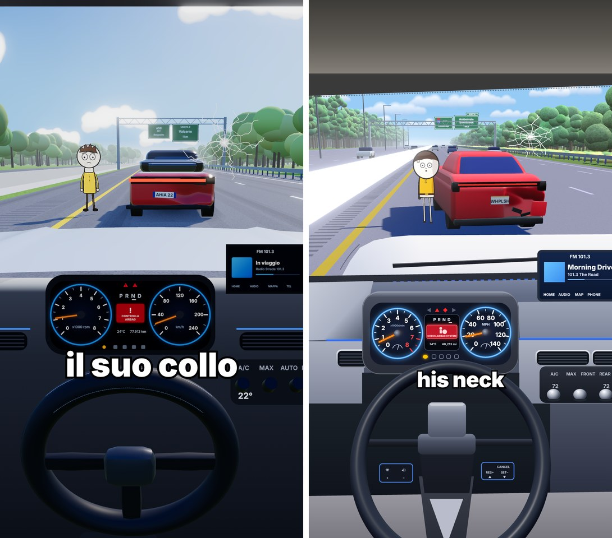
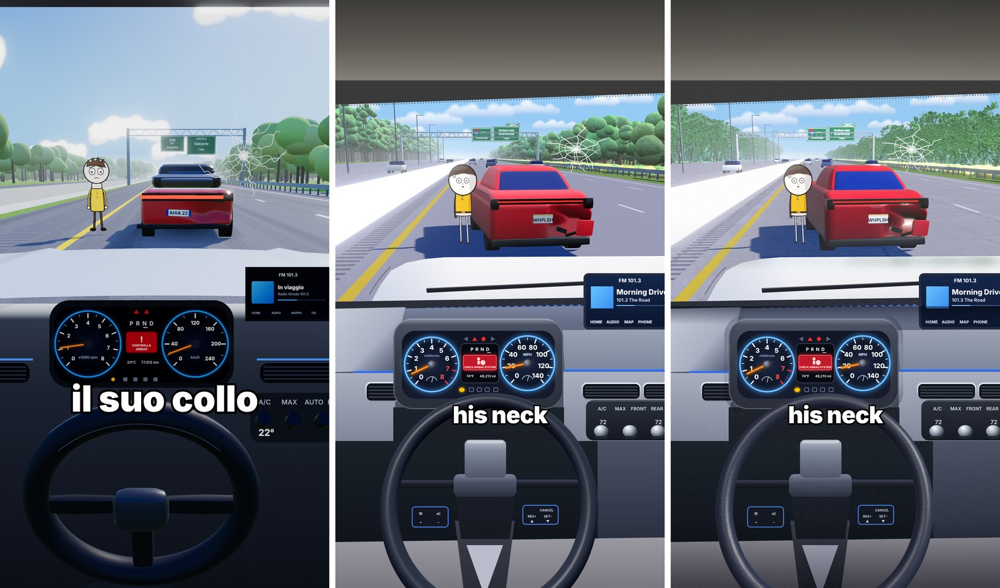
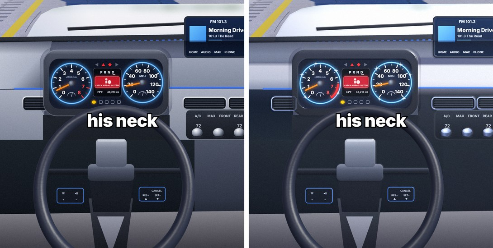
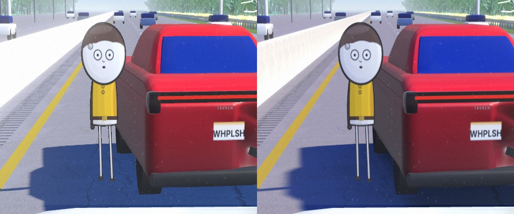

# Dalla v1 al frame finale: cosa è cambiato e perché



La **v1** (commit `fb1c4dc`) era una scena "nello stile di" quel video, costruita a occhio. Il **frame finale** ricostruisce il frame di riferimento misurandolo pixel per pixel. Il cambiamento più importante non è grafico ma di metodo: prima stimavo, poi ho misurato. Ogni numero nella scena ora viene da una misura sul riferimento.

## Quanto è più vicino (misura oggettiva)

Differenza media per pixel rispetto al riferimento: scala 0-255, **più basso = più simile**. Il calcolo esclude l'interfaccia di YouTube sovrapposta al video (`strumenti/metrica.py`).

| Versione | Tutto | Cielo + alberi | Strada + auto | Abitacolo |
|---|---|---|---|---|
| v1 | 59,4 | 48,1 | 57,9 | 61,5 |
| finale (b14) | **41,7** | **33,0** | **43,0** | **44,1** |
| miglioramento | −30% | −31% | −26% | −28% |

Questa metrica misura colore e posizione, non la forma. Dalla b5 in poi la forma dell'auto è migliorata molto a vista, anche se il numero cambia poco.

---

## 1. Il metodo: misurare invece di stimare

1. **Ritaglio del riferimento.** Lo screenshot (1440×3088) contiene il video tra y=125 e y=2860. L'ho ritagliato e scalato a 1080×1920 (fattore 0,702). Shorts taglia 34 px per lato, quindi le bande laterali sono escluse dal confronto.
2. **Griglia e campioni.** Ho sovrapposto una griglia ogni 50 px per leggere le coordinate. Poi ho campionato i colori facendo la media di 7×7 pixel (cielo, asfalto, ombre, vernice, cruscotto).
3. **Dal punto di fuga alla camera.** Le linee della strada convergono a (452, 515) px. Uno script ruota la camera (beccheggio e imbardata) finché il punto di fuga cade esattamente lì: risultato −15,56° e −3,04°.
4. **Dai pixel ai metri.** Con la camera fissata, ogni pixel diventa un raggio. Intersecando il raggio con il suolo (`atH`) o con un piano a profondità nota (`atZ`) ottengo la posizione reale. Così l'auto, il personaggio e le linee si collocano partendo da dove stanno nell'immagine (`strumenti/misura.mjs`).
5. **Verifica di coerenza.** Ho misurato la linea gialla in tre punti diversi. Con la camera a 1,3 m (come nella v1) i tre punti danno x diverse e l'auto risulta larga solo 1,36 m: impossibile. Con la camera a **1,8 m** la linea è dritta (x = −1,71 / −1,67 / −1,70) e l'auto è larga 1,95 m. Il riferimento è quindi girato da un SUV o pickup, non da un'auto bassa.
6. **Ciclo di correzione.** Render → immagini affiancate e sovrapposte al 50% → metrica per zona → correzione. In tutto 14 iterazioni (`confronto/iterazioni/`).

### Misure chiave

| Elemento | Pixel nel riferimento | Nel mondo 3D |
|---|---|---|
| Punto di fuga | (452, 515) | camera a 1,8 m, −15,56°, −3,04° |
| Linea gialla | (60,950) (165,840) (340,640) | x = −1,70 m |
| Spartitraffico | base (60,765), cima (60,622) | x = −2,95 m, alto 1,05 m |
| Bande sonore | (60,800) → (60,875) | x da −2,59 a −2,06 m |
| Personaggio | piedi (422,797), testa 543 | (−0,23; −10,5) m, alto 1,63-1,67 m |
| Auto rossa | paraurti x 497→858 a y 785 | retro a z = −9,0, centro x = 1,27, larga 1,95 m |
| Retro dell'auto | lunotto 545-610, luci 650, targa 698-728 | 1,64 / 1,29 / 1,07 / 0,81-0,64 m |
| Portale | traliccio x 215→665 a y 440 | z = −140, da x −19,5 a 17,9 m |
| Cofano | bordo a y 836-840, curva a sinistra | contorno dipinto con gli stessi punti |
| Quadro strumenti | 190-748 × 1040-1336; quadranti (316,1190) e (630,1186), r 92 | dipinto a pixel esatti |
| Volante | centro (505,1622), raggio esterno 355 px, cima 1325 | toro 3D a 0,85 m, inclinato di 33° |
| Sottotitolo | x 385→695, base a 1378 | dimensione del font calcolata per riempire la larghezza |

---

## 2. Cosa è cambiato, zona per zona

### Camera e composizione
| | v1 | finale | perché |
|---|---|---|---|
| Altezza camera | 1,3 m | **1,8 m** | unica altezza che rende dritta la linea gialla misurata |
| Orientamento | −13,5° fisso, nessuna imbardata | −15,56° e −3,04°, risolti dal punto di fuga | l'orizzonte era a y≈590, nel riferimento è a 515 |
| Posizionamento | coordinate inventate | **ogni oggetto calcolato da un pixel** (`atH`, `atZ`) | l'auto, il personaggio e le linee coincidono nella sovrapposizione |
| Auto rossa | a 12,5 m, centrata | a 9,0 m, centro x 1,27, ruotata di 0,1 rad | era troppo piccola; la rotazione mostra il fianco in ombra come nel riferimento |

### Luce e colore
| | v1 | finale | perché |
|---|---|---|---|
| Tone mapping | ACES (exposure 1,05) | **nessuno** | ACES sposta e desatura i colori; senza, si confrontano 1:1 con i campioni |
| Sole | davanti-destra, alto | da destra, leggermente davanti, ~40° di elevazione | le ombre nel riferimento vanno a sinistra, verso la camera |
| Ombre | grigie | **blu sature** (#29417d contro #193a71 del riferimento) | si tinge solo la luce indiretta di asfalto, erba e linee (`blueShadows`); auto e personaggio restano neutri |
| Riflessi | mappa d'ambiente presa dal cielo | mappa dedicata: cielo chiaro, orizzonte grigio-blu, terra scura | la vernice del riferimento riflette il suolo scuro in basso e il cielo in alto |
| Nebbia | densità 0,0026 | 0,0017 | gli alberi a 500 m nel riferimento sono ancora visibili al ~50% |

### Cielo
- Il gradiente ora è **ripido**: nel frame si vedono solo ~7° sopra l'orizzonte, quindi il colore passa da #dbe8f2 a #94c8f5 in pochi gradi. Nella v1 il gradiente era pensato per tutta la volta celeste.
- Nuvole: niente più sprite sfocati generici. Sono **cumuli cartoon a fondo piatto** con la base azzurrata, posizionati agli stessi pixel del riferimento (11 nuvole).

### Strada
- **Linee alle posizioni misurate**: gialla a −1,70; tratteggi a 2,05 / 5,8 / 9,85; bordo destro a 11,75, che poi si apre nella rampa d'uscita (nel riferimento la linea diverge: c'è l'uscita a 1 miglio).
- **Bande sonore** tra −2,59 e −2,06 m, prima inesistenti in quel punto.
- **Carreggiata opposta** allargata a 4 corsie, fino a x = −40: l'orizzonte d'erba a sinistra nel riferimento è più lontano.
- Asfalto grigio chiaro neutro (#b4b5b9) e riflessi del cielo ridotti a 0,12: con la tinta blu l'asfalto illuminato diventava viola (b2-b3).

### Spartitraffico, guardrail, pali, portale
- **Spartitraffico**: profilo alto 1,05 m e largo 0,9 m alla base, bianco (#f0eee8). Nella v1 era basso (0,85 m) e grigio.
- **Guardrail** a x = 15,6 m, blu-grigio come nel riferimento.
- **Pali della luce** a sinistra (prima assenti), da z = −62 m.
- **Portale**: da una trave sottile a un **traliccio a quattro correnti** bianco a z = −140 m. I cartelli sono posizionati ai pixel misurati, con i testi del riferimento: "58 EAST Cobbleridge", "Ambervale Quietbrook 1 MILE", "EXIT 9". La texture è leggermente emissiva (retroriflettente).

### Paesaggio
- **Alberi**: a destra 6-11 m oltre l'erba fiorita (x 24-85); a sinistra 15-23 m oltre la carreggiata opposta (x < −42). Le altezze sono ricavate dalla linea delle cime nel riferimento (y 355-400). Nella v1 erano troppo vicini e arrivavano fino al bordo del parabrezza.
- Chiome fatte di **16-26 grappoli** con texture a macchie di foglie e colore più chiaro in cima; prima erano sfere lisce e scure.
- **Fascia di cespugli fioriti gialli** tra il guardrail e gli alberi (nuova).

### Auto rossa
| | v1 | finale |
|---|---|---|
| Sagoma | due scatole (sembrava un pickup) | berlina: baule corto che sale verso il lunotto, abitacolo rastremato (−27% in alto), lunotto inclinato |
| Vetri | scatola nera | vetro blu (#0a2a9a) solo sopra la cintura (1,2 m), montanti rossi visibili |
| Luci | barra spessa molto luminosa | barra sottile (2,8 cm) dentro una fascia scura, fanali avvolgenti agli angoli |
| Ammaccatura | macchia di colore | deformazione più profonda (fino a 50 cm), pieghe con chiari e scuri, angolo del paraurti piegato in fuori, fessura nera, pezzo penzolante |
| Paraurti basso | rosso | nero opaco con due scarichi cromati |
| Volume | colore uniforme | parte bassa e fianco in ombra più scuri (colore per vertice) |
| Targa e marchio | "AHIA 22" | "WHPLSH" su targa con fascia arancione, marchio "TAVREN" |

### Personaggio
- **Proporzioni misurate**: testa 0-38% dell'altezza, maglia 33-63%, gambe 63-100%. Nella v1 la testa era al 30% e il corpo più largo.
- Stile del riferimento: capelli castani a calotta, bernoccolo sulla fronte, occhi tondi con pupille piccole, bocca piccola aperta, maglia gialla con due bottoni, cintura con fibbia e orlo chiaro, braccio sinistro in ombra, gambe chiare sottili con contorno.
- Tolto il collare cervicale: era una mia aggiunta, nel riferimento non c'è.
- La posizione e l'altezza vengono dai pixel dei piedi e della testa.

### Abitacolo: cambio di approccio
- **v1**: pannelli 3D sparsi davanti alla camera e cofano 3D. Era difficile allinearli, e il cofano copriva il cruscotto (bug corretto già nella v1).
- **Finale**: l'abitacolo è solidale alla camera, quindi l'ho **dipinto direttamente in coordinate schermo** su un unico canvas 1080×1920. Contiene cielo dell'abitacolo, fascia nera del parabrezza, crepa, cofano, tergicristallo, sbrinatore con LED blu, plancia, bocchette cromate, pannello clima, schermo radio, quadro strumenti, razze e mozzo del volante.
- Questo livello viene **disegnato dopo il mondo 3D**, senza tone mapping, quindi i colori sono esattamente quelli scritti. Si compone in tre passaggi: mondo 3D (con bloom) → abitacolo dipinto → corona del volante 3D.
- **Quadro**: da km/h a **MPH** come nel riferimento; contagiri con zona rossa 7-8; display "P R N D"; riquadro rosso "CHECK AIRBAG SYSTEM" con icona; "74°F 48,213 mi"; spie in alto e in basso.
- **Radio**: "FM 101.3 · Morning Drive · 101.3 The Road", schede HOME/AUDIO/MAP/PHONE.
- **Colori della plancia presi dai campioni**: la zona sotto il quadro è #181d23, non grigia come sembrava a occhio (vedi b7 → b13).
- **Volante**: corona 3D con raggio, inclinazione e spessore ricavati dai pixel, più le cuciture chiare. Mozzo, razze e pulsantiere ("CANCEL / RES+ / SET–") sono dipinti dietro la corona.

### Sottotitolo
- Da "il suo collo" a **"his neck"**, in Inter Black bianco con contorno nero e ombra.
- La dimensione del font non è più fissa: uno script la calcola perché il testo occupi esattamente la larghezza misurata (x 385→695), con la linea di base a 1378 px.

---

## 3. Cronologia delle iterazioni

Le immagini sono in `confronto/iterazioni/` (bNN.jpg).

| It. | Cosa ho cambiato | Tutto | Nota |
|---|---|---|---|
| b01 | Nuova scena: camera dal punto di fuga, oggetti da pixel, abitacolo dipinto | 45,8 | composizione già allineata; il volante non compare, lo spartitraffico manca |
| b02 | Volante in un passaggio separato, spartitraffico al suo posto, tinta blu delle ombre | 42,7 | asfalto viola: la tinta colpiva anche la parte illuminata |
| b03 | Sole più forte, luce ambiente più bassa, cielo | 42,6 | asfalto ancora bluastro |
| b04 | Riflessi del cielo ridotti a terra, mappa d'ambiente dedicata, lunotto e baule rifatti | 42,8 | strada finalmente grigia; auto da "pickup" a berlina |
| b05 | Carreggiata opposta larga, alberi più bassi e lontani, nuvole morbide, portale a traliccio | 42,1 | |
| b06 | Texture di foglie, cespugli gialli, pali spostati, cielo | 42,3 | altezze degli alberi a posto |
| b07 | Alberi a sinistra, volume dell'auto, plancia schiarita | 44,2 | **peggiorato**: la plancia schiarita era un errore di valutazione a occhio |
| b08 | Auto ruotata (fianco visibile), ammaccatura più forte, personaggio più grande | 44,2 | abitacolo dell'auto nero (bug) |
| b09 | Corretto il materiale nero (vertexColors senza attributo colore) | 44,2 | |
| b10-b12 | Lunotto più grande, abitacolo più rastremato, z-fighting del vetro eliminato | 44,2 | forma dell'auto migliorata, numero invariato |
| b13 | Plancia scurita ai colori **misurati** (#181d23) | 42,0 | abitacolo da 48,0 a 44,1 |
| b14 | Nebbia e cielo regolati sui campioni | **41,7** | frame finale |

---

## 4. Errori tecnici trovati lungo la strada

- **Volante invisibile (b01).** three.js disegna prima tutti gli oggetti opachi e poi quelli trasparenti, qualunque sia il `renderOrder`. Il pannello dipinto, trasparente, finiva sopra la corona. Soluzione: un passaggio di render separato solo per il volante.
- **Spartitraffico sparito (b01).** Un `ExtrudeGeometry` ruotato di 180° estrude verso −z, quindi partiva da 2,4 km di distanza. Soluzione: posizione z = +5.
- **Asfalto viola (b02-b03).** La tinta blu veniva applicata anche ai riflessi del cielo, presenti pure al sole. Soluzione: tinta solo sulla luce diffusa indiretta e riflessi ridotti a 0,12.
- **Abitacolo nero (b08).** Un materiale con `vertexColors: true` su una geometria senza attributo `color` diventa nero. Soluzione: un clone del materiale senza colori per vertice.
- **Bordo seghettato sul lunotto (b11).** Vetro e carrozzeria coincidevano (z-fighting). Soluzione: vetro 4,5 cm più fuori e tagliato più in basso.
- **Occhio contro misura (b07 → b13).** A vista la plancia sotto il quadro sembrava grigia, il campione dice #181d23. Ha ragione la misura: è il motivo per cui ogni colore ora ha il suo campione.

---

## 5. Cosa resta diverso (onestamente)

- **Auto**: meno lucida, l'ammaccatura è meno drammatica e la forma è più semplice di un modello vero. Per arrivarci serve un modello vero, per esempio un glTF.
- **Alberi**: grappoli di sfere con texture, non chiome dipinte. Con le carte di foglie (`alphaTest`) o i modelli Poly Haven del kit si avvicinerebbero molto.
- **Abitacolo**: è dipinto in 2D, quindi ha meno volume e meno riflessi dell'originale.
- **Personaggio**: ridisegnato nello stesso stile, non è un ricalco.
- **Interfaccia di YouTube** (titolo, pulsanti, canale): non riprodotta, perché non fa parte del video.
- **Testi e personaggio del riferimento** ("his neck", "WHPLSH", "TAVREN", cartelli, radio): li ho copiati solo per lo studio. Per un video da pubblicare usa i tuoi.

---

## 6. Come rifare il confronto

```bash
npm install
npm run render                                   # → frame.png
# metti lo screenshot ritagliato a 1080×1920 come riferimento.png (ignorato da git)
python3 strumenti/confronta.py riferimento.png frame.png confronto/oggi
python3 strumenti/metrica.py riferimento.png confronto/v1.png frame.png
node strumenti/misura.mjs 62 1.8                 # camera e posizioni ricavate dai pixel
```

---

# v3: texture reali e realismo



La v2 aveva forme e colori giusti, ma superfici lisce "da plastilina". La v3 sostituisce le texture disegnate a mano con **asset fotografici veri del kit** (Poly Haven, CC0), ricolorati sui colori misurati nel riferimento. Gli asset si preparano con `./prepara_asset.sh`.

| | v2 | v3 | perché |
|---|---|---|---|
| Asfalto | rumore disegnato su canvas | **asphalt_02** PBR (diffusa + normali + rugosità/AO), una ripetizione ogni 4 m | grana, crepe e rugosità vere che reagiscono al sole |
| Segnaletica | colore piatto | stessa normal map dell'asfalto sotto la vernice | la vernice segue la grana della strada |
| Erba | puntini disegnati | **leafy_grass** PBR | |
| Spartitraffico | bianco piatto | **concrete_floor_painted** PBR, senza AO e con riflessi bassi | cemento vero, ma bianco come nel riferimento |
| Riflessi | cielo finto dipinto | **cielo HDR fotografato** (kloofendal_48d_partly_cloudy) come mappa d'ambiente | vernice, vetri e metalli riflettono un cielo vero |
| Alberi | grappoli di sfere | **impostori** di 3 alberi veri (island_tree_01/02, tree_small_02): fotografati da 3 lati con la luce della scena (`bake.js`), usati come cartoncini rivolti alla camera | aspetto fotografico a un costo di 1 quadrato per albero; i modelli pesano 40-97 MB e non si possono istanziare a centinaia |
| Colore degli alberi | — | fogliame portato al verde misurato (`strumenti/colore_impostori.py`) | le foto originali sono verde oliva scuro, il riferimento è verde-acqua |
| Vetri | blu-viola (riflessi) | blu saturo #0a3cc8 con riflessi al 12% | misurato: lunotto #093cac |
| Vernice | rosa-chiara al sole | #d8052a, riflessi dimezzati, ammaccatura più scura | misurato: baule #c40e3c, pieghe #32050b |
| Volante | pelle liscia | normal map a grana di tessuto | |
| Abitacolo dipinto | piatto | occlusione ambientale dipinta nei bordi e negli incavi, grana della plastica, riflessi sfocati di cielo e alberi sul cofano, polvere sul parabrezza | sono i dettagli che fanno "foto" invece di "disegno" |
| Tutto il frame | pulito | grana della pellicola leggerissima + vignettatura al 12% | |

**Metrica** (più basso = più simile):

| | Tutto | Cielo + alberi | Strada + auto | Abitacolo |
|---|---|---|---|---|
| v2 (b14) | 41,7 | 33,0 | 43,0 | 44,1 |
| v3 (c07) | 42,5 | **30,6** | 43,3 | 45,7 |

La zona degli alberi è la migliore di sempre. Le altre peggiorano di poco perché il riferimento è un video compresso e liscio: la grana e la texture vere aggiungono dettaglio che la metrica conta come differenza. È uno scambio voluto, realismo contro somiglianza al pixel.

**Iterazioni c01-c07** (`confronto/iterazioni/`):
- **c01**: texture PBR e HDR. Asfalto con crepe troppo marcate, spartitraffico bianco bruciato.
- **c02**: alberi veri come impostori, ma troppo radi e scuri.
- **c03**: più alberi, abitacolo realistico, grana. Vignettatura troppo forte (al 28%).
- **c04-c06**: colore degli alberi calibrato sul campione e altezze riportate alla linea delle cime misurata. Zona alberi da 39,7 a 30,6.
- **c07**: vetro e vernice calibrati sui campioni.

**Lezione**: alzare la luminosità delle foto degli alberi non basta, perché il colore resta oliva. Bisogna moltiplicare ogni canale verso il verde campionato. Attenzione anche a `| head` dopo uno script Python: la pipe chiusa l'ha interrotto a metà e solo alcune foto erano state ricolorate.

---

# v4: riflessi reali su abitacolo e personaggio



Nella v3 il mondo 3D rifletteva il cielo HDR, ma l'abitacolo e il personaggio erano disegni piatti: nessun riflesso poteva toccarli. Nella v4 anche le superfici dipinte ricevono **luce e riflessi calcolati dal motore**, con lo stesso sole e lo stesso cielo del mondo.

**Come funziona** (`reliefNormal` in `scene.js`):
1. Accanto al disegno si dipingono altre tre mappe con le stesse coordinate: un **rilievo** in grigi (cornici e cromature sporgono, schermi e bocchette rientrano), un'**inclinazione** per zona (cofano e piano della plancia guardano in alto, i pannelli verticali no) e una mappa **rugosità/metallo** (vetro 0,07, vernice 0,2, cornice 0,3, plastica 0,6-0,7, cromo metallico).
2. Da rilievo e inclinazione si ricava una normal map.
3. Sopra il disegno si aggiunge uno strato con un materiale fisico nero che produce **solo riflessi** (cielo HDR + sole portato nello spazio della camera) e si somma al dipinto.

| | v3 | v4 | perché |
|---|---|---|---|
| Plancia (base) | grigio chiaro quasi ovunque | **scura**, con due sole fasce chiare tra y 1105 e 1215 | campionata a griglia (13 righe × 9 colonne): sotto i LED è #0d1624-#1b2029, non grigia |
| Cornice del quadro | gradiente dipinto chiaro | base scura + bordo lucido dato dal riflesso sullo smusso | nel riferimento è nera con un filo di luce in alto |
| Bocchette, manopole, anelli | bianco dipinto | **cromo vero** (metallo, rugosità 0,16) sopra una base blu-acciaio | |
| Quadranti | puliti | zona rossa luminosa 7-8, bagliori a stella sugli anelli | presenti nel riferimento |
| Cofano | bianco con riflessi dipinti | vernice lucida che riflette il cielo | |
| Personaggio | disegno piatto con una mezzaluna grigia dipinta | **ombreggiatura reale** (rilievo a cupola sulla testa e bombato sul busto, illuminato dal sole da destra e moltiplicato sul disegno) + strato di riflessi | nel riferimento la testa passa da #fdfdfc (destra) a #d6d3da (sinistra); ora da #eef5fb a #dde3f3 |

**Metrica** (più basso = più simile):

| | Tutto | Cielo + alberi | Strada + auto | Abitacolo |
|---|---|---|---|---|
| v3 (c07) | 42,5 | 30,6 | 43,3 | 45,7 |
| v4 (d06) | **38,6** | 31,8 | 43,3 | **38,2** |

**Iterazioni d01-d06:**
- **d01**: riflessi troppo forti, un velo chiaro su tutto. Abitacolo da 45,7 a 59,9: bocciata.
- **d02**: intensità dell'ambiente da 1,15 a 0,28. Torna a 46,9, ma il confronto ravvicinato mostra che il vero errore è la **base** della plancia, troppo chiara.
- **d03**: plancia ridipinta sui campioni. Abitacolo a 38,7: il salto più grande dopo la v2.
- **d04**: cornice scura, cromature, manopole, zona rossa e bagliori.
- **d05**: ombreggiatura sul personaggio troppo scura (tutta la testa a #b4b9c5): il cartoncino guarda la camera e il sole arriva di lato.
- **d06**: moltiplicatore a 1,75, così il lato al sole resta pieno. Tolta la mezzaluna dipinta, che stava dal lato sbagliato.

**Lezioni:**
- Prima di aggiungere riflessi, verificare la base con una griglia di campioni: i riflessi su un colore di base sbagliato non possono sembrare veri.
- Un riflesso sommato non si vede su una superficie già bianca. Lì serve l'ombreggiatura in moltiplica.
- Il cielo HDR è molto luminoso: per uno strato di soli riflessi l'intensità giusta è intorno a 0,3, non 1.

**Cosa resta diverso:** il tratto del personaggio (nell'originale il contorno è più spesso), l'auto rossa (serve un modello vero), la pelle del volante (nell'originale ha riflessi più marcati).

---

# v5 (prototipo): rendering a passaggi, "alla Blender" senza Blender



Blender Cycles calcola la luce sparando molti campioni e facendo la media. Qui si fa lo stesso con three.js: lo stesso frame viene renderizzato N volte con piccole variazioni e alla fine si fa la media (`progressive()` in `scene.js`, attivo con `?passaggi=N`).

A ogni passaggio cambiano tre cose (sequenze di Halton, deterministiche):
1. **Il sole** si sposta dentro un disco di circa 1,5°: le ombre diventano morbide ai bordi come quelle vere.
2. Una **luce di cielo con ombre** arriva da una direzione diversa della volta (distribuzione coseno). Sostituisce quasi tutta la luce ambiente piatta: dove il cielo è coperto (sotto l'auto, accanto allo spartitraffico, intorno al personaggio) arriva meno luce. È l'occlusione del cielo di Cycles.
3. **La camera** si sposta di frazioni di pixel: i bordi escono senza scalette.

**Il colore delle ombre ora viene dalla fisica**, non dalla tinta finta: la luce del cielo è blu (#3a66ff), quindi dove il sole è coperto il suolo è illuminato solo dal cielo e diventa blu da solo.

| | Render singolo | 32 passaggi | Riferimento |
|---|---|---|---|
| Ombra dell'auto | #334d88 | **#253771** | #193a71 |
| Asfalto al sole | #a2a3b7 | #9e9bb2 | #a8aab7 |
| Tempo per frame (questo server) | 15 s | **95 s** (~2,7 s a passaggio) | — |
| Metrica totale | 38,6 | 38,7 | — |

La metrica resta uguale perché misura i colori medi. Il guadagno è nella **qualità della luce** (penombre, occlusione, bordi), che una differenza media per pixel quasi non vede.

**Errore trovato:** la prima versione accumulava in un buffer float sulla GPU e mostrava i colori sbagliati. Prima del tutto più chiaro, poi, dopo la "correzione", troppo scuro e saturo. Un **test di controllo** (1 passaggio con le stesse luci del render normale, che deve venire identico) ha mostrato che nessuna delle due varianti era giusta. Soluzione: ogni passaggio usa la catena normale già verificata, e la media si fa sui pixel finali letti dalla GPU. Il test di controllo ora coincide entro 1-2 livelli.

**Comandi:**
- `npm run render`: qualità, 32 passaggi (~95 s);
- `npm run render:veloce`: 1 passaggio (~15 s), per le iterazioni.

**Per un video**: 10 s a 30 fps con 32 passaggi = circa 8 ore su questo server; con 8 passaggi, circa 2 ore e mezza.

## Ricerca di modelli d'auto migliori (esito)

L'auto resta la parte meno fedele perché è costruita a mano con scatole smussate. Ho cercato modelli liberi:
- **Kit della libreria GitHub** (release v1 del cartoon-kit): nessuna auto, solo `covered_car` (un'auto coperta da un telo).
- **GitHub (raggiungibile da questa sessione):**
  - Kenney Car Kit (CC0): trovato, ma è *low-poly giocattolo*, meno realistico della nostra;
  - un modello di berlina più dettagliato in un altro repository: **senza licenza dichiarata**, non usato;
  - due collezioni di auto: salvate con Git LFS, che questa sessione non può scaricare.
- **Siti con modelli realistici** (Poly Haven, Kenney, Sketchfab, Poly Pizza, OpenGameArt): **bloccati dalla rete di questa sessione**. Vanno aggiunti agli host consentiti nelle impostazioni dell'ambiente, oppure si scaricano a mano e si mettono nel kit.
- Il **CarConcept** di Khronos (CC-BY 4.0) è un'auto concept futuristica, non adatta.

Prossimo passo consigliato: aggiungere al kit (release GitHub) una o più berline realistiche con licenza CC0 o CC-BY, così la skill le trova da sola.
