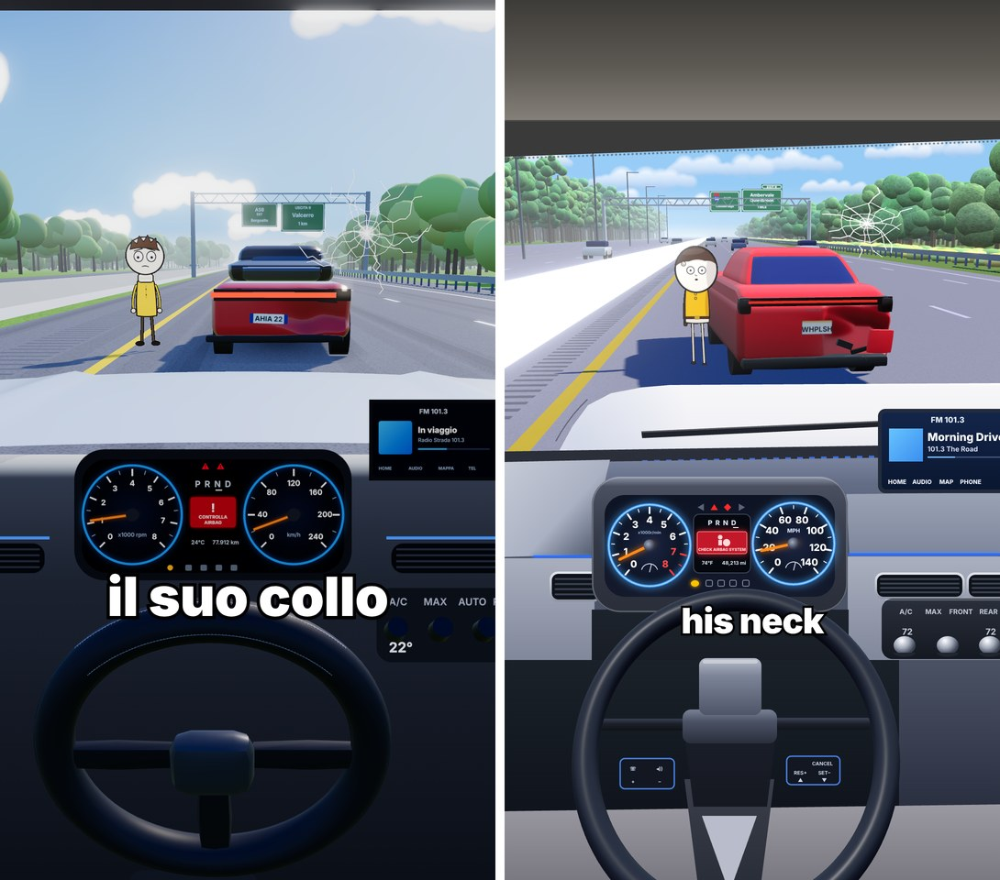

# Frame "autostrada" (POV abitacolo + personaggio 2D)

Un singolo frame 1080×1920 fatto solo di codice, senza AI e senza asset scaricati. Ricostruisce un frame di riferimento **misurandolo**: camera ricavata dal punto di fuga, ogni oggetto posizionato a partire dai suoi pixel, colori presi da campioni.



- **Mondo 3D** (three.js r160, PBR): cielo a gradiente ripido, nuvole a fondo piatto, autostrada con linee, bande sonore, spartitraffico, guardrail, pali, portale a traliccio con cartelli, alberi istanziati, traffico. Ombre blu sature solo a terra.
- **Berlina tamponata**: carrozzeria deformata per vertice (ammaccatura con pieghe, angolo del paraurti piegato), vetri, luci con bloom, targa e marchio su canvas.
- **Personaggio 2D**: disegno su canvas applicato a un piano rivolto alla camera, con un'ombra vera che ha la sua sagoma.
- **Abitacolo**: un unico livello dipinto a pixel esatti (cofano, plancia, quadro, radio, clima), sopra il quale si disegna la corona 3D del volante.
- **Sottotitolo** in HTML/CSS, dimensionato per riempire la larghezza misurata.

```bash
npm install
./prepara_asset.sh    # scarica dal kit texture PBR, cielo HDR e alberi veri; li ricolora e fotografa gli alberi
npm run render        # → frame.png (Playwright + Chromium headless)
```

La v3 usa asset reali del kit (Poly Haven, CC0): asfalto, erba e cemento PBR, cielo HDR per i riflessi e alberi veri come "impostori". Il metodo (taratura su un riferimento, rendering a passaggi, impostori, ricerca dei modelli) è ora parte della skill `cartoon-storie`: `.claude/skills/cartoon-storie/references/migliora-frame.md`.

- [`CAMBIAMENTI.md`](CAMBIAMENTI.md): cosa è cambiato dalla v1 al finale e perché (metodo, misure, tabelle prima/dopo, 14 iterazioni, errori trovati, differenze residue).
- `strumenti/`: `misura.mjs` (camera e posizioni dai pixel), `confronta.py` (immagini affiancate e sovrapposte), `metrica.py` (differenza per zona).
- `confronto/`: render della v1 e di tutte le iterazioni.

Per un video: rendi la scena funzione del numero di frame (scorrimento della strada, oscillazione della camera, posa del personaggio), salva un PNG per frame e unisci tutto con ffmpeg.
